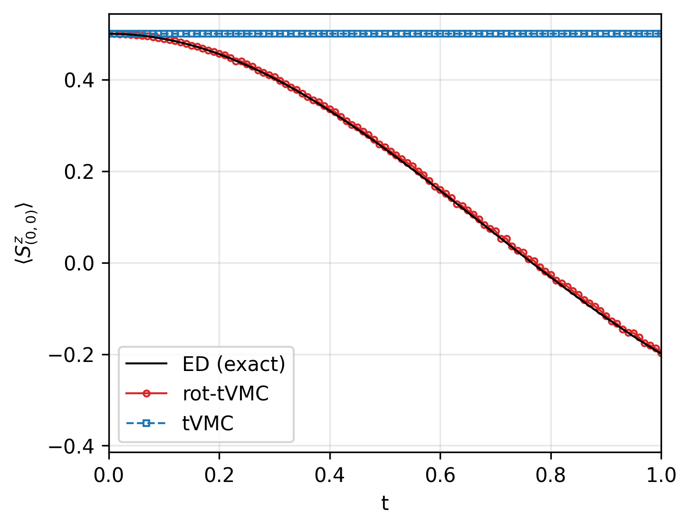
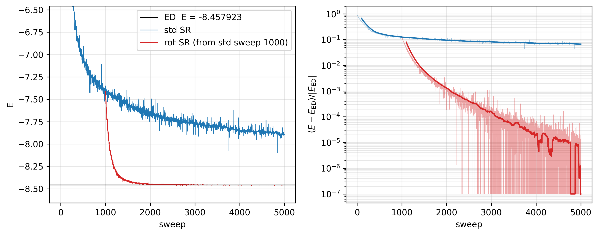

# Rotation sampling

Local-rotation VMC / tVMC on top of [NetKet](https://www.netket.org): the variational state is
sampled in a locally rotated basis, `ψ → U†ψ` with a 2x2 (one site) or 4x4 (one bond) unitary `U`, and
the Hamiltonian is rotated accordingly, `H → U†HU`. Expectation values are unchanged, but the sampled
distribution now has support where the plain ansatz has none, which removes the sampling pathologies
of stochastic reconfiguration and tVMC discussed in our paper
([arXiv:2606.23657](https://arxiv.org/abs/2606.23657), see [Citation](#citation)).

## Installation

The environment is locked with [uv](https://docs.astral.sh/uv/): `pyproject.toml` pins the direct
dependencies (the versions the results in this repository were produced with, Python 3.12) and
`uv.lock` every transitive package, so one command recreates the same environment:

```bash
git clone git@github.com:chenjl517/rotation-sampling.git
cd rotation-sampling
uv sync                      # CPU
uv sync --extra gpu          # + CUDA 12 build of JAX
uv sync --extra ptvmc        # + ptvmc-systematic-study (p-tVMC demos), fixed commit
uv run python examples/parity_mixing/run_rot.py     # or: source .venv/bin/activate
```

The package `local_rot_vmc/` is used in place; the example scripts add the repository root to
`sys.path`, so no further installation step is needed.

## Examples

Every example is a pair `run_std.py` (standard method) / `run_rot.py` (with local rotation) reading a
`config.toml` next to the scripts. Common options: `--gpu N` (sets `CUDA_VISIBLE_DEVICES` before JAX
starts) and `--config PATH`. Results go to `results/history_*.npz`, checkpoints to `ckpts/`.
`examples/plot.ipynb` plots every example against exact diagonalisation (blue = std, red = rot,
black = exact).

### 1. Charged local-operator quench (`quench_dynamics/`)

Local quench `S+_0 |GS⟩` on the 4x4 PBC J1-J2 XXZ model with an RBM ansatz.

Model and ansatz are shared in `config_model.toml`; each sub-directory has its own algorithm `config.toml`.
Prepare the RBM ground state and the exact reference once:

```bash
cd examples/quench_dynamics
python generate_initial_state_gs.py           # fit RBM_gs to the ED ground state → ckpts/
python ed_dynamics_heisen.py                  # exact ⟨Sz_i⟩(t) → ed_reference/
```

#### tVMC (`tvmc_quench_4x4/`, 1-site Hadamard rotation)

```bash
cd tvmc_quench_4x4
python run_std.py --gpu 0
python run_rot.py --gpu 0
```

⟨Sz⟩ on the quenched site. Plain tVMC never leaves the initial configuration of that site.

<p align="center"></p>

#### p-tVMC (`ptvmc_quench_4x4/`, 2-site Hadamard rotation)

```bash
cd ptvmc_quench_4x4
python run_std.py --gpu 0
python run_rot.py --gpu 0
```

⟨Sz⟩ on the quenched site and its neighbour, final infidelity of every time step, and the inner
optimisation of the first step.

<p align="center"></p>

### 2. Other applications

#### Parity mixing (`parity_mixing/`, 8-site TFIM chain, RBM)

Benchmark of Wan, Wiersema & Zhang ([arXiv:2603.18148](https://arxiv.org/abs/2603.18148), Fig. 5a):
the even-parity state `|ψ_even⟩` is encoded exactly in an RBM and evolved under the TFIM.
Plain tVMC never samples the odd sector and `P_Z` stays frozen; the 1-site rotation fixes it.

```bash
cd examples/parity_mixing
python parity_rbm.py                          # optional: verify the RBM encoding of |ψ_even⟩
python ed_dynamics_tfim.py                    # exact P_Z(t) → ed_reference/ (also computed on demand)
python run_std.py --gpu 0
python run_rot.py --gpu 0
```

`P_Z(t)`; plain tVMC (blue, drawn to t = 0.01) stays at `P_Z = 1`.

<p align="center"></p>

#### Ground-state optimization (`gs_optimization/`, 4x4 J1-J2 Heisenberg, lookup ansatz)

```bash
cd examples/gs_optimization
python ed_ground_state.py --J2 0.5            # reference energy → ed_reference/
python run_std.py --gpu 0                     # NetKet VMC_SR, checkpoint every ckpt_every sweeps
python run_rot.py --gpu 0                     # rot-SR from the std checkpoint of [rotation] init_sweep
python run_rot.py --gpu 0 --load ckpts/std_ckpt_heis_4x4_pbc_j1_1.0_j2_0.5_001000.pkl   # explicit checkpoint
```

Energy per sweep (left) and relative error to ED (right); rot-SR starts from the std checkpoint of sweep 1000.

<p align="center"></p>

## Citation

```bibtex
@misc{chen2026resolvingsupportmismatchlocalbasis,
      title={Resolving support-mismatch by local basis rotation in variational Monte Carlo},
      author={Jia-Lin Chen and Zhen Fan and Canhui Yan and Yantao Wu and Tao Xiang},
      year={2026},
      eprint={2606.23657},
      archivePrefix={arXiv},
      primaryClass={cond-mat.str-el},
      url={https://arxiv.org/abs/2606.23657},
}
```
