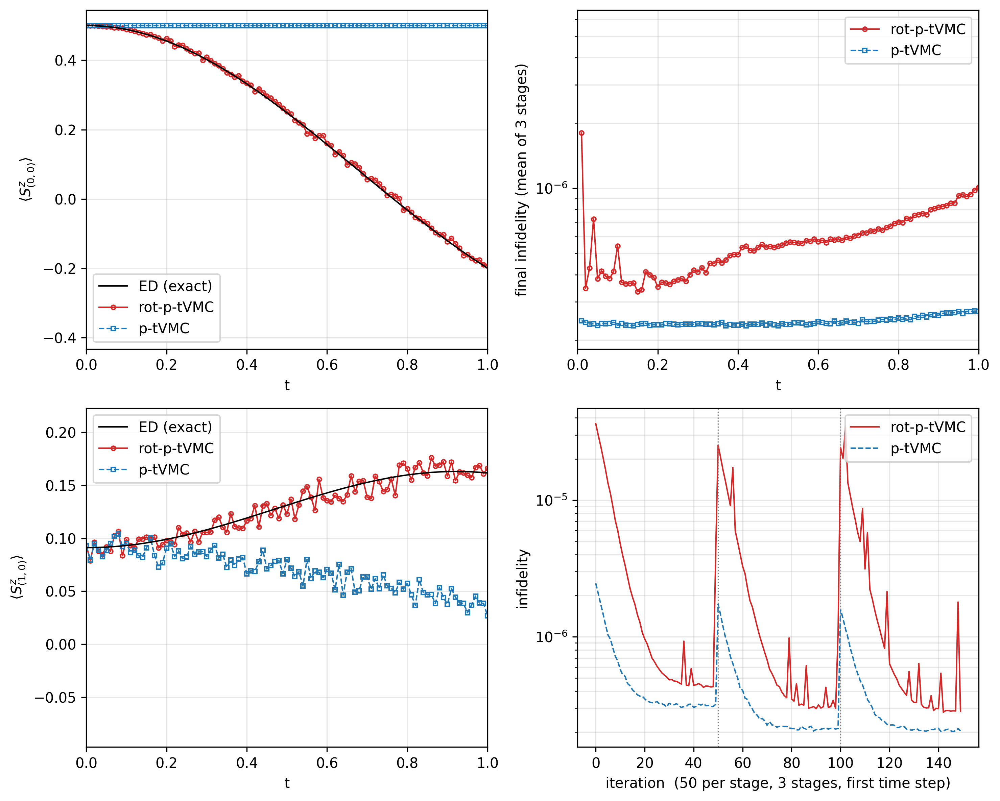
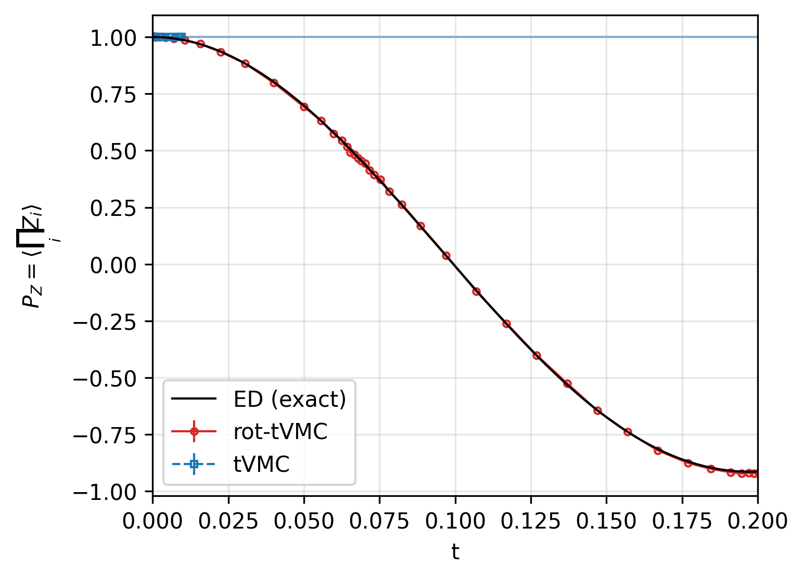

# Rotation sampling

Official implementation of **rotation sampling** built on top of [NetKet](https://www.netket.org), accompanying the preprint [arXiv:2606.23657](https://arxiv.org/abs/2606.23657).

Monte Carlo methods for quantum many-body simulation become biased whenever sampling misses zero-amplitude configurations that still drive the evolution—a pathology known as **support mismatch**. 

Rotation sampling provides a sampling-level plug-in: applying unitary basis transformations to recover the missing support.

This repository provides ready-to-run demos demonstrating rotation sampling across **time-dependent VMC (tVMC)**, **projected tVMC (p-tVMC)**, and **ground-state stochastic reconfiguration (SR)**.


## Installation
```bash
git clone git@github.com:chenjl517/rotation-sampling.git
cd rotation-sampling
uv sync                      # CPU
uv sync --extra gpu          # + CUDA 12 build of JAX
uv sync --extra ptvmc        # + ptvmc-systematic-study (p-tVMC demos), fixed commit
uv run python examples/parity_mixing/run_rot.py     # or: source .venv/bin/activate
```

## Examples

Each benchmark pairs run_std.py (standard) with run_rot.py (rotation sampling) using a local config.toml.

### 1. Local quench (`quench_dynamics/`)

Local quench $S^+_0 | GS\rangle$ on the 4×4 periodic XY model with an RBM ansatz. Applying $S_0^+$ zeros out all configurations with a down spin at site 0, creating support mismatch that freezes standard sampling.

#### Initial state preparation
Prepare the RBM ground state and the exact reference once:
```bash
cd examples/quench_dynamics
python generate_initial_state_gs.py           # prepare RBM_gs
python ed_dynamics_heisen.py                  # exact ⟨Sz_i⟩(t) → ed_reference/
```

#### tVMC (`tvmc_quench_4x4/`)

```bash
cd tvmc_quench_4x4
python run_std.py --gpu 0
python run_rot.py --gpu 0
```

<p align="center"></p>

#### p-tVMC (`ptvmc_quench_4x4/`)

```bash
cd ptvmc_quench_4x4
python run_std.py --gpu 0
python run_rot.py --gpu 0
```

<p align="center"></p>


### 2. Parity mixing (`parity_mixing/`)

Real-time evolution of an 8-site periodic transverse-field Ising (TFI) chain initialized in an equal-weight superposition of all even-parity states |ψ_even⟩ (encoded exactly in an RBM), following [arXiv:2603.18148](https://arxiv.org/abs/2603.18148). 

Standard tVMC fails to sample the odd-parity sector and freezes at $\langle P_Z \rangle = 1$. Here we show that a single-site Hadamard rotation restores full support and recovers the dynamics.

```bash
cd examples/parity_mixing
python parity_rbm.py                          # optional: verify the RBM encoding of |ψ_even⟩
python ed_dynamics_tfim.py                    # exact P_Z(t) → ed_reference/ (also computed on demand)
python run_std.py --gpu 0
python run_rot.py --gpu 0
```

<p align="center"></p>

### 3. Ground-state optimization (`gs_optimization/`)
Ground-state optimization of the frustrated 4×4 periodic J₁-J₂ Heisenberg model at J₂/J₁ = 0.5 (lookup-table ansatz). 

Changing the sign of a real amplitude requires passing through zero, where the configuration becomes rarely or never sampled, trapping standard SR in an optimization plateau. Switching to rot-SR at sweep 1000 restores sampling access and recovers the exact ground-state energy and sign structure.

```bash
cd examples/gs_optimization
python ed_ground_state.py --J2 0.5            # reference energy → ed_reference/
python run_std.py --gpu 0                     # NetKet VMC_SR, checkpoint every ckpt_every sweeps
python run_rot.py --gpu 0                     # rot-SR from the std checkpoint of [rotation] init_sweep
python run_rot.py --gpu 0 --load ckpts/std_ckpt_heis_4x4_pbc_j1_1.0_j2_0.5_001000.pkl   # explicit checkpoint
```

Energy per sweep (left) and relative error to ED (right); rot-SR starts from the std checkpoint of sweep 1000.

<p align="center"></p>

## Citation

If you find this code useful in your research, please consider citing our preprint:

```bibtex
@misc{chen2026resolvingsupportmismatchlocalbasis,
      title={Resolving support-mismatch by local basis rotation in variational Monte Carlo},
      author={Jia-Lin Chen and Zhen Fan and Canhui Yan and Yantao Wu and Tao Xiang},
      year={2026},
      eprint={2606.23657},
      archivePrefix={arXiv},
      primaryClass={cond-mat.str-el},
      url={https://arxiv.org/abs/2606.23657},
}
```
